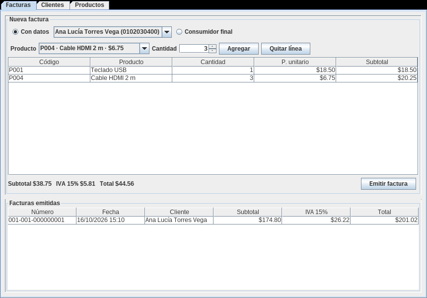
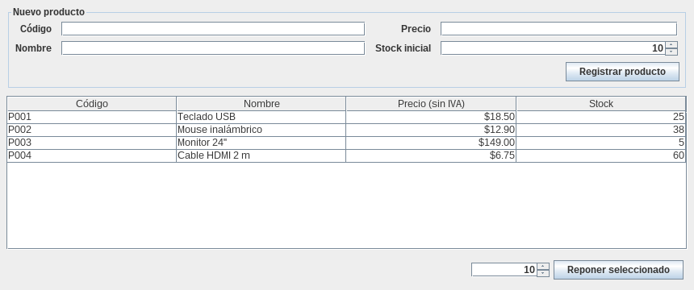

# java-facturacion-jtable

[](https://github.com/Whiteherobot/java-facturacion-jtable/actions/workflows/ci.yml)

Sistema de facturación de escritorio en Java Swing, organizado en capas MVC y
con las listas en `JTable`. Ejercicio de Programación Orientada a Objetos (junio
de 2022), en grupo.



- **Clientes**: registro con cédula ecuatoriana validada (dígito verificador).
- **Productos**: código, precio sin IVA y stock, con reposición desde la tabla.
- **Facturas**: se elige un cliente o consumidor final, se agregan productos
  (si se repite un producto se suma a la misma línea) y se emite. La factura
  calcula subtotal, IVA del 15% y total, descuenta el stock y recibe un número
  con el formato del SRI (`001-001-000000001`). A consumidor final solo se puede
  facturar hasta $50, como exige el SRI. Si una factura se rechaza (por falta de
  stock o por superar el límite), el inventario no cambia.



## Cómo correrlo

Necesitas JDK 17 o superior. El proyecto trae el wrapper de Maven.

```bash
./mvnw verify                                 # compila y corre las pruebas
java -jar target/facturacion-jtable-1.0.0.jar
```

La aplicación arranca con algunos clientes y productos de ejemplo. Las cédulas
son números de prueba que cumplen el dígito verificador.

## Estructura

```
src/main/java/facturacion/
├── modelo/       Cliente, Producto, Factura, LineaFactura y Dinero (IVA, redondeo, límites)
├── servicio/     Repositorio genérico en memoria y uno por entidad
├── controlador/  Registro de clientes y productos, emisión de facturas
└── vista/        Ventana con pestañas, un panel por módulo y ModeloTabla (modelo de JTable)
```

Los montos se manejan con `BigDecimal` y redondeo a dos decimales. Cada línea
guarda el precio del momento de la venta, así una factura emitida no cambia si
después cambia el producto. Las pruebas cubren los cálculos, la emisión (stock,
numeración y límites) y los paneles, y corren en GitHub Actions con Java 17 y 21.

## Qué cambió desde la entrega

En 2022 eran tres ventanas sueltas con formularios cuyo botón "Mostrar"
imprimía en la consola. Las vistas con `JTable` quedaron como plantillas de
NetBeans sin terminar. El modelo no cerraba: `Producto` no tenía precio ni
código (se buscaba por el costo de envío), la factura no tenía cliente ni
productos, y las búsquedas devolvían un objeto vacío cuando no encontraban
nada. En 2026 se rehízo como un sistema de facturación completo, manteniendo
la arquitectura de capas y la opción de consumidor final de la entrega.

## Autores

- Michael Lata ([@Whiteherobot](https://github.com/Whiteherobot))
- Gabriela Rocano

Licencia MIT.
